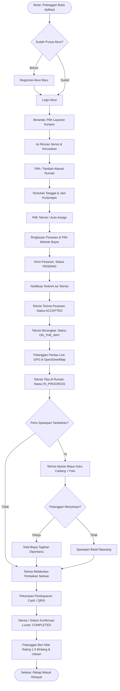
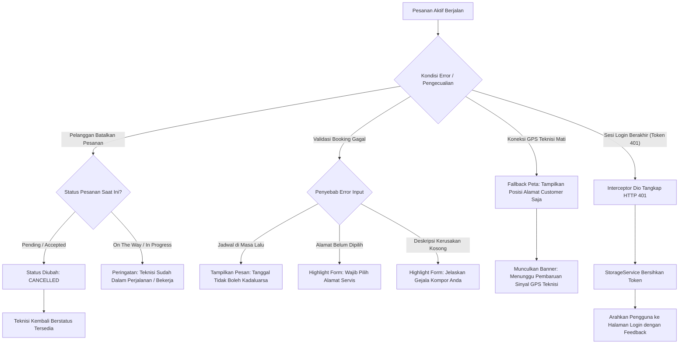

# LAPORAN ASESMEN INTERAKSI MANUSIA DAN KOMPUTER (ATS IMK)
**Proyek:** Sistem Layanan Servis Kompor Gas (*KlikKompor*)  
**Arsitektur Solusi:** Laravel 11 Backend & Web Dashboard Administrator + Flutter Mobile Client (Multi-Role: Pelanggan & Teknisi)  
**Peran Analis:** UX Researcher & System Analyst  

---

## 1. UX Research

### A. Target Pengguna
Berdasarkan skema otentikasi (`users`, `2026_09_24_115019_add_klikkompor_fields_to_users_table.php`) serta otorisasi role (`customer`, `technician`, `admin`), terdapat 3 aktor utama:
1. **Pelanggan (*Customer*):** Pengguna perumahan, pemilik warung makan, indekos, atau apartemen yang mengalami kendala teknis pada kompor gas (kebocoran gas, api merah, pemantik mati).
2. **Teknisi Mitra (*Technician*):** Tenaga kerja lapangan terverifikasi ahli servis gas dan kompor portabel/tanam, yang bertugas menerima order, mengunjungi lokasi pelanggan, melakukan perbaikan, dan mengajukan komponen/biaya tambahan.
3. **Administrator (*Admin*):** Pengelola platform internal yang mengawasi tata kelola layanan, verifikasi berkas teknisi (KTP terenkripsi, sertifikat), laporan transaksi, dan audit log keamanan via portal Web Admin.

### B. Karakteristik & Konteks Penggunaan
| Role | Profil & Karakteristik | Konteks & Lingkungan Penggunaan |
| :--- | :--- | :--- |
| **Pelanggan** | - Rentang usia 20–60 tahun (ibu rumah tangga, pekerja kantor, pelaku UMKM kuliner).<br>- Butuh solusi cepat karena kendala kompor gas berhubungan dengan bahaya api/ledakan dan terhentinya aktivitas memasak harian.<br>- Memiliki variasi literasi digital, mengutamakan alur pemesanan yang ringkas, transparan, dan komunikatif. | Menggunakan *smartphone* dalam kondisi darurat atau terburu-buru di dapur/rumah; membutuhkan kepastian estimasi waktu kedatangan (*live tracking*) serta kejelasan rincian tarif. |
| **Teknisi** | - Teknisi lapangan usia 22–50 tahun, mobilitas tinggi menggunakan sepeda motor.<br>- Mengutamakan kemudahan navigasi GPS, status pekerjaan sekali sentuh (*toggle* online, berangkat, mulai kerja, selesai), dan transparansi pendapatan/komisi. | Menggunakan aplikasi mobile di luar ruangan dengan satu tangan atau saat memakai sarung tangan kerja; rentan terhadap koneksi internet yang fluktuatif di lokasi pelanggan. |
| **Admin** | - Staf operasional & manajerial dengan literasi komputer tinggi.<br>- Berorientasi pada data tabel, monitoring matriks transaksi, kecepatan verifikasi mitra, dan validasi rekonsiliasi pembayaran. | Menggunakan browser desktop/laptop di ruang kantor dengan layar monitor lebar untuk mengelola banyak data secara simultan. |

### C. Kebutuhan Pengguna (*User Needs*)
- **Pelanggan:**
  - Menemukan layanan perbaikan yang tepat berdasarkan jenis kompor (kompor gas 1/2 tungku, kompor tanam, oven gas, kompor restoran/komersial).
  - Mengetahui perkiraan tarif awal dan biaya transportasi secara transparan sebelum teknisi datang.
  - Memantau pergerakan teknisi secara *real-time* dan berkomunikasi langsung melalui chat tanpa harus bertukar nomor pribadi.
  - Mendapatkan rincian jelas jika ada penggantian sparepart darurat di tempat beserta bukti foto dan persetujuan formal (*approval*).
- **Teknisi:**
  - Fleksibilitas dalam menyalakan/mematikan status kehadiran (*toggle active/ready status*).
  - Menerima pesanan terdekat beserta rincian titik jemput (peta OpenStreetMap, alamat lengkap, dan catatan khusus).
  - Mengajukan penambahan ongkos/sparepart secara resmi di sistem agar terhindar dari tuduhan pungutan liar (*dispute* tarif).
  - Melihat ringkasan pendapatan harian/mingguan dan rekap performa rating ulasan bintang.
- **Admin:**
  - Mengawasi arus pesanan (*order pipeline*) dari status *pending* hingga *completed*.
  - Memverifikasi dokumen teknisi secara aman tanpa melanggar privasi data (enkripsi KTP teknisi via OpenSSL di database).
  - Mengelola master katalog servis, tarif dasar, kategori kompor, dan mencetak laporan pendapatan platform.

### D. Permasalahan Pengguna (*Pain Points*)
1. **Asimetri Informasi Biaya:** Pelanggan sering khawatir ditipu oleh teknisi liar dengan harga suku cadang yang dinaikkan sepihak di lokasi servis.
2. **Ketidakpastian Waktu Kedatangan:** Pelanggan tidak tahu apakah teknisi benar-benar sedang menuju lokasi atau masih di tempat lain.
3. **Kekhawatiran Keamanan & Privasi:** Mengundang orang asing ke dalam dapur rumah memerlukan teknisi yang jelas identitasnya, tersertifikasi, dan terpantau oleh sistem.
4. **Pencatatan Manual bagi Teknisi:** Teknisi sering lupa mencatat pengeluaran suku cadang kecil sehingga mengalami selisih perhitungan saat penagihan akhir kepada konsumen.

---

## 2. Problem Definition

### A. Problem Statement
1. **Pelanggan (*Customer*):**  
   > *“Pelanggan rumah tangga membutuhkan akses pemesanan teknisi kompor gas terverifikasi dengan rincian biaya yang transparan dan pelacakan posisi GPS secara waktu-nyata, karena mereka sering merasa waswas terhadap keselamatan instalasi gas, ketidakpastian waktu kedatangan teknisi, serta potensi manipulasi harga suku cadang di tempat.”*

2. **Teknisi Mitra (*Technician*):**  
   > *“Teknisi servis membutuhkan antarmuka kerja mobile yang ringkas untuk mengelola status pesanan, memperbarui titik lokasi, dan mengajukan suku cadang tambahan berlampirkan bukti foto, karena pencatatan manual di lapangan rawan memicu perselisihan tarif dengan pelanggan dan menghambat pencairan upah servis.”*

3. **Administrator (*Admin*):**  
   > *“Admin operasional membutuhkan dasbor terpusat untuk memvalidasi legalitas mitra teknisi dan mengawasi sirkulasi transaksi servis secara aman, karena pengelolaan manual ratusan order lapangan berisiko terhadap kebocoran data sensitif serta keterlambatan rekonsiliasi keuangan.”*

### B. Pertanyaan *How Might We* (HMW)
- **HMW 1 (Transparansi Tarif):** *Bagaimana kita bisa membuat pelanggan merasa aman dan memiliki kendali penuh terhadap setiap biaya tambahan atau penggantian sparepart yang diajukan oleh teknisi saat servis berlangsung?*  
  *(Dijawab oleh modul `additional_costs` dengan mekanisme status `pending -> approved/rejected` di mobile).*
- **HMW 2 (Kepastian Layanan):** *Bagaimana kita bisa memberikan kepastian waktu kedatangan teknisi ke lokasi pelanggan tanpa membingungkan kedua belah pihak?*  
  *(Dijawab oleh OpenStreetMap GPS tracking, timeline interaktif, dan status pesanan bertahap: pending -> accepted -> on_the_way -> in_progress -> completed).*
- **HMW 3 (Aksesibilitas Lapangan):** *Bagaimana kita bisa merancang antarmuka teknisi yang tetap mudah dioperasikan di lapangan dengan satu tangan di tengah kondisi kerja yang kotor atau terburu-buru?*  
  *(Dijawab oleh tombol aksi status berukuran besar, toggle switch ketersediaan, dan modal form pengajuan biaya yang ringkas).*
- **HMW 4 (Privasi & Kepercayaan):** *Bagaimana kita bisa menjaga keamanan identitas teknisi dan rasa percaya pelanggan saat berinteraksi di dalam platform?*  
  *(Dijawab oleh enkripsi AES-256 data KTP teknisi di database, fitur in-app chat tanpa mengekspos nomor pribadi, serta sistem review bintang & ulasan publik).*

---

## 3. User Requirements

### A. Daftar Kebutuhan Fungsional (FR) & Non-Fungsional (NFR)

#### Kebutuhan Fungsional (FR)
- **FR-01 (Autentikasi Multi-Peran):** Sistem harus mengizinkan registrasi dan autentikasi terpisah untuk Pelanggan, Teknisi (mobile via Sanctum Bearer Token), dan Administrator (web session).
- **FR-02 (Manajemen Alamat Pelanggan):** Pelanggan dapat menambah, mengubah, menandai alamat utama (*default*), dan menghapus lokasi servis beserta pin koordinat latitude/longitude.
- **FR-03 (Eksplorasi Katalog & Booking):** Pelanggan dapat memilih jenis layanan servis kompor, memilih jadwal tanggal/jam, menentukan merek/jenis kompor, dan memilih teknisi terdekat.
- **FR-04 (Pembaruan Status Pesanan Lapangan):** Teknisi dapat memperbarui status pesanan secara sekuensial: *Accepted* $\rightarrow$ *On the Way* $\rightarrow$ *In Progress* $\rightarrow$ *Completed*.
- **FR-05 (Pengajuan Biaya Tambahan Berfoto):** Teknisi dapat menginput item sparepart, harga satuan, jumlah, dan mengunggah foto bukti; sistem menahan penambahan total tagihan sampai disetujui pelanggan.
- **FR-06 (Pelacakan Lokasi & Peta Waktu-Nyata):** Sistem menampilkan visualisasi posisi pelanggan dan teknisi menggunakan OpenStreetMap serta garis rute poliline saat status *on_the_way*.
- **FR-07 (Komunikasi Pesanan Terintegrasi):** Pelanggan dan teknisi dapat saling mengirim pesan dalam ruang obrolan (*in-app chat*) yang terikat pada ID pesanan aktif.
- **FR-08 (Pembayaran & Konfirmasi Pelunasan):** Pelanggan dapat memilih metode pembayaran (*cash, QRIS, transfer*), dan teknisi/admin dapat mengonfirmasi status *paid*.
- **FR-09 (Rating & Ulasan Kinerja):** Pelanggan dapat memberikan nilai rating (1–5 bintang) dan testimoni setelah servis berstatus *completed*.

#### Kebutuhan Non-Fungsional (NFR)
- **NFR-01 (Usability & Responsiveness):** Antarmuka mobile harus responsif terhadap berbagai ukuran layar (minimal lebar 360dp, standar iOS/Android), kontras warna tombol utama (*primary orange* `#FA7D10`) memenuhi standar WCAG AA ($\ge 4.5:1$).
- **NFR-02 (Keamanan Data & Privasi):** Nomor KTP teknisi dienkripsi dengan standar industri (Laravel Encrypter/AES-256-CBC) dan data sensitif ditutup dari respons API publik.
- **NFR-03 (Performance & Polling):** Waktu respons API untuk update status dan lokasi di bawah 1.5 detik; polling status order tracking pada aplikasi mobile berjalan efisien tiap 8 detik tanpa menyebabkan kebocoran memori (*memory leak*).
- **NFR-04 (Reliability & Fault Tolerance):** Form input dilengkapi validasi sisi klien (*client-side form validation*) dan penanganan fallback graceful (misal: jika koordinat GPS belum aktif, peta tidak crash dan menampilkan pesan informatif).

### B. User Stories & Acceptance Criteria

#### User Story 1: Pemesanan Servis Kompor (Pelanggan)
> **Sebagai** seorang Pelanggan,  
> **Saya ingin** memilih jenis kerusakan kompor, menentukan alamat, dan menjadwalkan kedatangan teknisi,  
> **Agar** kompor gas saya yang bermasalah dapat segera diperbaiki oleh teknisi resmi di rumah.

*Acceptance Criteria:*
- **Given** Pelanggan telah login dan berada di halaman detail layanan.
- **When** Pelanggan menekan tombol "Pesan Sekarang", memilih alamat dari daftar alamat tersimpan, memilih tanggal kunjungan (tidak boleh di masa lalu), memilih slot waktu, dan mengisi deskripsi kerusakan.
- **Then** Sistem menampilkan ringkasan biaya (subtotal + tarif transportasi Rp15.000).
- **And** Ketika pesanan dikirim, sistem membuat rekaman pesanan baru berstatus `pending`, menghasilkan nomor order berformat `KP-YYYYMMDD-XXXXX`, dan mengirimkan notifikasi ke teknisi terkait.

#### User Story 2: Persetujuan Biaya Suku Cadang Tambahan (Pelanggan & Teknisi)
> **Sebagai** seorang Pelanggan,  
> **Saya ingin** melihat dan menyetujui rincian biaya sparepart tambahan yang diajukan teknisi saat perbaikan,  
> **Agar** total biaya tagihan akhir tetap transparan dan sesuai dengan kesepakatan saya.

*Acceptance Criteria:*
- **Given** Pesanan berada dalam status `in_progress` dan teknisi menemukan komponen yang aus (misal: selang/regulator rusak).
- **When** Teknisi menginput nama suku cadang, jumlah, harga satuan, dan menekan "Kirim Pengajuan Biaya".
- **Then** Sistem mencatat data di tabel `additional_costs` dengan status `pending` dan mengirimkan notifikasi ke Pelanggan.
- **When** Pelanggan menekan tombol "Setujui (*Approve*)", status berubah menjadi `approved`, dan sistem secara otomatis memperbarui nilai `total_amount` pada pesanan utama.
- **If** Pelanggan menekan "Tolak (*Reject*)", biaya tersebut tidak ditambahkan ke tagihan akhir dan teknisi mendapat pemberitahuan status penolakan.

#### User Story 3: Pembaruan Status & Navigasi Pekerjaan (Teknisi)
> **Sebagai** seorang Teknisi Mitra,  
> **Saya ingin** memperbarui status perjalanan dan pengerjaan servis secara bertahap langsung dari aplikasi,  
> **Agar** pelanggan dan kantor pusat mengetahui progres servis tanpa perlu menelepon berulang kali.

*Acceptance Criteria:*
- **Given** Teknisi telah menerima pesanan di menu Pesanan Masuk.
- **When** Teknisi menekan tombol "Mulai Berangkat", status pesanan berubah menjadi `on_the_way`, koordinat GPS teknisi mulai dipetakan, dan pelanggan melihat posisi teknisi di peta.
- **When** Teknisi tiba di lokasi dan menekan "Mulai Servis", status pesanan berganti menjadi `in_progress`.
- **When** Servis selesai dan pembayaran diverifikasi, teknisi menekan "Selesaikan Pesanan", status berganti menjadi `completed`, dan waktu `completed_at` dicatat di sistem.

---

## 4. Information Architecture

### A. Sitemap Lengkap (Pohon Hierarki Sistem)

```
SISTEM KLIKKOMPOR
│
├── [PORTAL WEB ADMIN] (Desktop View)
│   ├── /admin/login (Otentikasi Session Administrator)
│   ├── /admin/forgot-password & /admin/reset-password
│   └── /admin/dashboard (Dasbor Operasional Terpusat)
│       ├── Manajemen Pesanan (/admin/orders) [Filter status, detail, batalkan]
│       ├── Manajemen Teknisi (/admin/technicians) [Verifikasi KTP terenkripsi, ubah status aktif]
│       ├── Pelanggan Terdaftar (/admin/customers) [Daftar akun, riwayat servis]
│       ├── Katalog Servis (/admin/services) [Kategori kompor, item servis, harga dasar]
│       ├── Transaksi & Pembayaran (/admin/payments) [Verifikasi QRIS/transfer, riwayat pelunasan]
│       ├── Ulasan & Reputasi (/admin/reviews) [Moderasi ulasan bintang, tanggapan]
│       ├── Notifikasi Sistem (/admin/notifications) [Broadcast pengumuman sistem]
│       ├── Laporan Keuangan & Audit Log (/admin/reports & /admin/activity-logs)
│       └── Pengaturan Profil & Sistem (/admin/profile & /admin/settings)
│
└── [APLIKASI MOBILE KLIKKOMPOR] (Flutter Client)
    │
    ├── Modul Autentikasi
    │   ├── /splash (Splash Screen)
    │   ├── /landing (Landing Page Pengenalan Fitur)
    │   ├── /login (Login Akun dengan validasi role)
    │   ├── /register (Registrasi Akun Baru)
    │   └── /forgot-password (Permintaan Tautan Reset Sandi)
    │
    ├── Area Pelanggan (Customer Workspace)
    │   ├── [Tab 1] Beranda (/customer/home)
    │   │   ├── Banner Promo & Edukasi Keamanan Gas
    │   │   ├── Quick Order & Pilihan Kategori Kompor
    │   │   ├── Teknisi Unggulan Terdekat
    │   │   └── Riwayat Servis Berjalan (Active Card)
    │   │       │
    │   │       ├── /customer/catalog (Katalog Lengkap Layanan)
    │   │       ├── /customer/service-detail (Rincian Biaya & Deskripsi Servis)
    │   │       ├── /customer/booking-summary (Form Booking: Tanggal, Waktu, Keluhan)
    │   │       ├── /customer/select-address (Buku Alamat & Form Tambah/Ubah Alamat)
    │   │       ├── /customer/select-technician (Pilih Teknisi Mitra)
    │   │       └── /customer/payment (Instruksi Pembayaran: Cash / QRIS / Transfer)
    │   │
    │   ├── [Tab 2] Riwayat & Pelacakan Pesanan (/customer/order-history)
    │   │   ├── /customer/order-tracking (Peta GPS OSM, Live Marker, Polyline, Approval Biaya)
    │   │   └── /customer/review (Beri Rating 1-5 Bintang & Ulasan Servis)
    │   │
    │   ├── [Tab 3] Pesan Obrolan (/customer/chat)
    │   │   └── /customer/chat/detail (Ruang Chat Pesanan Real-Time dengan Teknisi)
    │   │
    │   └── [Tab 4] Akun Profil (/customer/profile)
    │       ├── /customer/notification (Pusat Notifikasi Status & Promo)
    │       ├── /customer/edit-address (Manajemen Buku Alamat)
    │       └── /customer/help-center (Pusat Bantuan & FAQ Masalah Gas)
    │
    └── Area Teknisi (Technician Workspace)
        ├── [Tab 1] Dasbor Teknisi (/technician/dashboard)
        │   ├── Switch Status Online/Offline (Availability Toggle)
        │   ├── Ringkasan Pekerjaan Hari Ini & Total Saldo/Komisi
        │   ├── /technician/incoming-orders (Daftar Order Masuk / Siap Diterima)
        │   └── /technician/order-detail (Detail Lokasi, Kerusakan, Aksi Status Kerja)
        │       ├── /technician/customer-location (Peta Rute Alamat Pelanggan)
        │       ├── /technician/update-status (Pergantian Status: Menuju Lokasi / Bekerja)
        │       └── /technician/additional-cost (Pengajuan Sparepart Baru + Unggah Foto)
        │
        ├── [Tab 2] Obrolan Kerja (/technician/chat)
        │   └── Room Obrolan Pelanggan terkait Pesanan
        │
        ├── [Tab 3] Riwayat Pekerjaan (/technician/service-history)
        │   └── Rekap Servis Selesai & Dibatalkan
        │
        └── [Tab 4] Performa & Profil (/technician/profile)
            ├── /technician/income (Rincian Penghasilan & Riwayat Pencairan)
            └── /technician/performance (Statistik Rating Bintang & Review Pelanggan)
```

### B. Struktur Navigasi
1. **Navigasi Utama Mobile (`CustomBottomNavBar`):**  
   Mengadopsi pola *Persistent Bottom Navigation Bar* dengan 4 menu utama yang disesuaikan dengan peran pengguna:
   - **Mode Pelanggan:** `Beranda` (indeks 0) $\rightarrow$ `Aktivitas/Pesanan` (indeks 1) $\rightarrow$ `Pesan Chat` (indeks 2) $\rightarrow$ `Profil` (indeks 3).
   - **Mode Teknisi:** `Dasbor Kerja` (indeks 0) $\rightarrow$ `Pesan Chat` (indeks 1) $\rightarrow$ `Riwayat Servis` (indeks 2) $\rightarrow$ `Profil & Performa` (indeks 3).
2. **Navigasi Kontekstual & Hierarkis (Stack Push-Pop):**  
   Alur transaksi pemesanan menggunakan transisi tumpukan (*stack navigation*) dengan animasi *smooth fade transition* (`RouteGenerator._fadeRoute`). Tombol *Back* di AppBar selalu membawa pengguna kembali ke tahapan sebelumnya tanpa menghilangkan state data yang sudah dipilih.
3. **Navigasi Web Admin (Sidebar + Breadcrumb):**  
   Web admin menggunakan pola tata letak *Fixed Sidebar* di sebelah kiri untuk navigasi antar-modul dan area konten dinamis di sisi kanan, dilengkapi badge notifikasi order baru secara otomatis.

---

## 5. User Flow

### A. Alur Tugas Utama (*Main Flow*): Siklus Lengkap Pemesanan & Servis



### B. Alur Alternatif & Penanganan Error (*Alternative & Error Flow*)



---

## 6. Evaluasi Prototype / Implementasi UI terhadap Prinsip Wireframe

```
┌────────────────────────────────────────────────────────────────────────┐
│                        DAFTAR ASPEK EVALUASI IMK                       │
├────────────────────────────────────────────────────────────────────────┤
│ 1. Kesesuaian Struktur Layar dengan Kebutuhan Pengguna                  │
│ 2. Kejelasan Hierarki dan Penempatan Informasi                         │
│ 3. Kelengkapan Elemen Antarmuka (Tombol, Form, Feedback, Empty State)  │
│ 4. Konsistensi Struktur dan Navigasi Antarhalaman                      │
│ 5. Kesesuaian Alur Interaksi dengan User Flow                           │
│ 6. Kejelasan Fungsi Setiap Komponen dan Hubungan Antarhalaman          │
└────────────────────────────────────────────────────────────────────────┘
```

---

### Aspek 1: Kesesuaian Struktur Layar dengan Kebutuhan Pengguna
- **File Spesifik yang Dianalisis:**  
  `mobile/lib/screens/customer/customer_booking_summary_screen.dart` dan `mobile/lib/screens/technician/technician_dashboard_screen.dart`.
- **Temuan Kekurangan Saat Ini:**  
  1. Pada formulir pemesanan pelanggan (`customer_booking_summary_screen.dart`), kolom input `stove_brand` (merek kompor) dan `stove_type` (kompor tanam/kompor gas portable) belum disajikan sebagai *chip pilihan cepat* melainkan hanya bergantung pada teks catatan umum, sehingga pelanggan yang awam sering bingung menuliskan jenis kompor mereka.
  2. Pada dasbor teknisi (`technician_dashboard_screen.dart`), tombol pengalih status siaga (*ready/active toggle*) berada di posisi yang berdekatan dengan kartu riwayat ringkas, rentan tertekan tanpa sengaja saat menggulir layar (*accidental tap*).
- **Rekomendasi Perbaikan Konkret:**  
  1. Tambahkan komponen visual pemilihan merek populer (Rinnai, Quantum, Modena, Electrolux) berbentuk *horizontal icon chip* pada form booking agar pengguna tinggal mengetuk merek kompornya.
  2. Berikan dialog konfirmasi singkat atau slider konfirmasi bergaya *swipe-to-toggle* pada status kehadiran teknisi untuk mencegah ketidaksengajaan beralih status offline saat mengantongi ponsel.

---

### Aspek 2: Kejelasan Hierarki dan Penempatan Informasi
- **File Spesifik yang Dianalisis:**  
  `mobile/lib/screens/customer/customer_order_tracking_screen.dart` dan `resources/views/admin/orders.blade.php`.
- **Temuan Kekurangan Saat Ini:**  
  1. Di layar pelacakan pelanggan (`customer_order_tracking_screen.dart`), banner status gradient diletakkan di bawah peta OpenStreetMap. Padahal informasi paling mendesak bagi pengguna adalah *"Status Pesanan Saat Ini"* (Apakah teknisi sudah berangkat atau masih bersiap). Peta berukuran 240dp menyita separuh layar atas sehingga teks status terdorong ke bawah garis lipatan layar (*below the fold*).
  2. Tombol tindakan *"Batalkan Pesanan"* dan *"Konfirmasi Selesai & Beri Ulasan"* memiliki bobot visual yang hampir seimbang ketika status pekerjaan mencapai tahap perbaikan.
- **Rekomendasi Perbaikan Konkret:**  
  1. Terapkan pola *bottom sheet collapsible* (seperti aplikasi ride-hailing Grab/Gojek): peta tampil memenuhi latar belakang atas, sementara kartu status, estimasi menit kedatangan, dan identitas teknisi disematkan pada kartu mengambang (*floating status card*) yang langsung terbaca dalam 2 detik pertama.
  2. Bedakan hierarki visual tombol: gunakan gaya *Filled Button* oranye mencolok untuk aksi utama penyelesaian/ulasan, dan ubah tombol pembatalan menjadi *Low-Emphasis Text Button* berwarna abu-abu/merah redup di posisi sekunder.

---

### Aspek 3: Kelengkapan Elemen Antarmuka (Komponen Form, Feedback, Empty State)
- **File Spesifik yang Dianalisis:**  
  `mobile/lib/screens/customer/customer_select_address_screen.dart` dan `mobile/lib/screens/customer/customer_order_history_screen.dart`.
- **Temuan Kekurangan Saat Ini:**  
  1. Pada halaman riwayat pesanan (`customer_order_history_screen.dart`), saat daftar pesanan kosong atau jaringan mengalami *timeout*, teks error hanya berupa tulisan abu-abu statis tanpa adanya tombol aksi pemulihan (*Retry CTA*) dan tanpa ilustrasi kosong (*empty state illustration*) yang ramah pengguna.
  2. Pada pemilihan alamat servis (`customer_select_address_screen.dart`), penanda titik koordinat (latitude & longitude) masih menggunakan nilai koordinat default (*hardcoded fallback* Jakarta) jika perangkat pengguna menolak izin GPS atau browser tidak mengizinkan akses lokasi.
- **Rekomendasi Perbaikan Konkret:**  
  1. Sediakan komponen visual standar `EmptyStateWidget` lengkap dengan tombol *"Pesan Servis Sekarang"* saat riwayat kosong, serta tombol *"Muat Ulang Halaman"* saat request API gagal.
  2. Tambahkan widget pemilih lokasi peta interaktif (mini-map picker dengan pin geser) pada form tambah alamat agar pengguna dapat mengoreksi titik lokasi rumahnya secara presisi jika GPS otomatis meleset.

---

### Aspek 4: Konsistensi Struktur dan Navigasi Antarhalaman
- **File Spesifik yang Dianalisis:**  
  `mobile/lib/screens/customer/customer_chat_screen.dart` dan `mobile/lib/screens/technician/technician_chat_screen.dart`.
- **Temuan Kekurangan Saat Ini:**  
  1. Layar obrolan pelanggan (`customer_chat_screen.dart`) menampilkan daftar percakapan yang di-group per ID order, namun di layar teknisi (`technician_chat_screen.dart`), struktur visual bubble chat menggunakan padding dan radius sudut gelembung pesan yang berbeda (`16dp` vs `12dp`) dan warna latar bubble pesan keluar yang tidak konsisten dengan tema warna primer.
  2. Variabel penamaan rute obrolan: pelanggan diarahkan ke `/customer/chat/detail`, sedangkan pada teknisi obrolan digabung di dalam rute `/technician/chat` tanpa halaman detail terpisah, menciptakan inkonsistensi arsitektur navigasi.
- **Rekomendasi Perbaikan Konkret:**  
  1. Standarisasikan komponen obrolan ke dalam satu widget bersama (misal: `AppChatBubble` dan `AppChatView`) di direktori `mobile/lib/widgets/chat/` sehingga baik teknisi maupun pelanggan mendapatkan pengalaman estetika visual yang seragam.
  2. Samakan skema parameter rute obrolan: gunakan argumen `{required int orderId, required String recipientName}` untuk kedua role.

---

### Aspek 5: Kesesuaian Alur Interaksi dengan User Flow
- **File Spesifik yang Dianalisis:**  
  `mobile/lib/screens/customer/customer_payment_screen.dart` dan `app/Http/Controllers/Api/OrderController.php` (fungsi `pay`).
- **Temuan Kekurangan Saat Ini:**  
  1. Pada alur pembayaran tunai (*Cash on Delivery*), pelanggan diwajibkan menekan tombol bayar di halaman pembayaran untuk mengubah status menjadi terkonfirmasi. Padahal dalam transaksi riil servis kompor, pembayaran tunai baru diserahkan kepada teknisi setelah kompor benar-benar menyala normal dan dites di depan pelanggan.
  2. Jika pelanggan memilih QRIS, tampilan kode QR bersifat gambar statis tanpa adanya penghitung waktu mundur kedaluwarsa (*countdown timer payment*), sehingga pelanggan tidak mengetahui batas toleransi pembayaran.
- **Rekomendasi Perbaikan Konkret:**  
  1. Untuk metode `Cash`, buat alur otomatis: pesanan langsung berpindah ke status menunggu teknisi tanpa menahan pelanggan di layar konfirmasi bayar, dan konfirmasi pelunasan uang fisik sepenuhnya didelegasikan ke teknisi saat pekerjaan selesai.
  2. Tambahkan widget waktu mundur (misal: *“Selesaikan pembayaran dalam 14:59 menit”*) pada metode QRIS dan tombol interaktif *"Saya Sudah Membayar"* yang melakukan pengecekan ulang status secara asinkron.

---

### Aspek 6: Kejelasan Fungsi Setiap Komponen dan Hubungan Antarhalaman
- **File Spesifik yang Dianalisis:**  
  `mobile/lib/screens/technician/technician_order_detail_screen.dart` dan `mobile/lib/screens/customer/customer_service_detail_screen.dart`.
- **Temuan Kekurangan Saat Ini:**  
  1. Di layar detail pekerjaan teknisi (`technician_order_detail_screen.dart`), tombol *"Tambah Biaya Tambahan"* ditempatkan di dalam daftar gulir bawah (*scroll view*) bercampur dengan rincian keluhan, sehingga teknisi kerap kesulitan menemukannya saat ingin menambahkan komponen baru di tengah proses servis.
  2. Pada kartu layanan (`customer_service_detail_screen.dart`), tidak terdapat penjelasan yang membedakan antara *"Tarif Dasar Jasa Servis"* dengan *"Biaya Suku Cadang"* (misal: apakah harga Rp75.000 sudah termasuk pembersih spuyer atau murni ongkos perbaikan teknisi). Hal ini dapat menimbulkan salah persepsi pada pelanggan pertama.
- **Rekomendasi Perbaikan Konkret:**  
  1. Letakkan tombol *"Ajukan Suku Cadang / Biaya"* pada bilah aksi bawah yang persisten (*persistent sticky bottom bar*) selama status servis berada pada `in_progress`.
  2. Cantumkan label keterangan transparan pada rincian layanan: *"Tarif ini mencakup biaya jasa perbaikan & pengecekan kebocoran. Biaya suku cadang/regulator baru dikenakan terpisah atas persetujuan Anda."*

---

### Matriks Rangkuman Temuan Evaluasi IMK

| No | Komponen / File UI | Masalah Keterpakaian (Usability Issue) | Prinsip IMK yang Terdampak | Rekomendasi Solusi UX |
| :---: | :--- | :--- | :--- | :--- |
| **1** | `customer_order_tracking_screen.dart` | Peta 240dp menggeser status pesanan ke bawah lipatan layar. | *Hierarchy & Visibility of System Status* | Ubah menjadi *bottom sheet layout* mengambang di atas peta. |
| **2** | `customer_booking_summary_screen.dart` | Merek dan tipe kompor belum memiliki pilihan chip cepat. | *Recognition over Recall & Error Prevention* | Tambahkan horizontal chip merek kompor populer. |
| **3** | `technician_dashboard_screen.dart` | Toggle ketersediaan online mudah tertekan tidak sengaja. | *User Control & Accidental Action Prevention* | Ganti switch standar dengan modal atau *swipe-to-toggle*. |
| **4** | `customer_order_history_screen.dart` | Empty state dan error state tidak memiliki tombol aksi *retry*. | *Help Users Recognize, Diagnose, and Recover* | Sediakan CTA muat ulang dan tombol pesan servis baru. |
| **5** | `technician_order_detail_screen.dart` | Tombol biaya tambahan tersembunyi di bagian bawah form scroll. | *Flexibility & Efficiency of Use* | Pindahkan ke *sticky bottom action bar* saat status `in_progress`. |
| **6** | `customer_chat_screen.dart` vs `technician_chat_screen.dart` | Padding, warna bubble, dan struktur navigasi rute tidak seragam. | *Consistency and Standards* | Ekstraksi ke widget terpadu `AppChatView` & samakan pola routing. |

