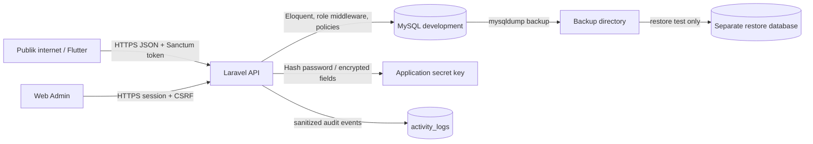

# Data Asset Inventory dan Security Boundary

## Konteks

KlikKompor adalah platform pemesanan jasa servis kompor gas. Backend menggunakan
Laravel 13.33.0, PHP 8.4, Laravel Sanctum, Eloquent, dan MySQL 8.0.41 pada
environment development lokal. Aktor aplikasi adalah `customer`, `technician`,
`admin`, dan proses `system`.

Dokumen ini menggambarkan aset berdasarkan migration, model, route, dan
controller yang ada di repository. Tidak ada data production yang digunakan
untuk audit ini.

## Inventaris fitur dan aset data

| Fitur | Tabel | Data penting | Aktor |
|---|---|---|---|
| Registrasi, login, reset password | `users`, `password_reset_tokens`, `personal_access_tokens` | Identitas, password hash, token sesi, token reset | Semua aktor |
| Profil dan role | `users`, `technician_profiles` | Role, status aktif, KTP, skill, verifikasi, lokasi | User pemilik, admin |
| Katalog layanan | `service_categories`, `service_items`, `technician_services` | Nama layanan, tarif, relasi layanan teknisi | Publik membaca, admin mengubah |
| Buku alamat | `addresses` | Nama penerima, telepon, alamat, koordinat | User pemilik |
| Pesanan | `orders`, `order_items` | Identitas pelanggan, lokasi, keluhan, jadwal, harga, status | Customer, technician, admin |
| Status pesanan | `order_status_logs` | Perubahan status, aktor, catatan, koordinat teknisi | Customer, technician, admin |
| Pembayaran | `payments` | Nominal, metode, bukti, referensi transaksi, payload gateway | Customer, admin |
| Biaya tambahan | `additional_costs` | Sparepart, harga, foto bukti, status persetujuan | Technician, customer, admin |
| Chat | `chats`, `chat_messages` | Pesan, lampiran, status dibaca | Peserta pesanan |
| Notifikasi | `notifications` | Pesan dan metadata event | User penerima |
| Review | `reviews` | Rating, komentar, foto, relasi pesanan | Customer, technician |
| Audit | `activity_logs` | Aktor, event, entity, IP, user-agent, perubahan | Admin/security |

## Data sensitif

| Data | Tabel/kolom | Klasifikasi awal | Perlindungan saat ini |
|---|---|---|---|
| Password | `users.password` | Sensitive | Laravel `hashed` cast/`Hash::make`; tidak boleh ditampilkan |
| Token sesi | `personal_access_tokens.token` | Sensitive | Tidak boleh dibaca aplikasi sebagai plaintext |
| Token reset | `password_reset_tokens.token` | Sensitive | Disimpan hash, tetapi alur response dan expiry perlu diperbaiki |
| Identitas kontak | `users.email`, `users.phone` | Confidential | Akses dibatasi aplikasi; audit harus masking |
| Alamat dan koordinat | `users.address`, `addresses.*`, `orders.address`, latitude/longitude | Sensitive | Object authorization; enkripsi at-rest belum diterapkan |
| Identitas teknisi | `technician_profiles.ktp_number` | Sensitive | Hidden dari serialization; enkripsi at-rest belum diterapkan |
| Pembayaran | `payments.proof_url`, `transaction_reference`, `payload` | Sensitive | Akses berbasis order; enkripsi/retensi belum ditetapkan |
| Percakapan | `chat_messages.message`, `attachment_url` | Confidential | Akses berbasis peserta order |
| Audit metadata | `activity_logs.ip_address`, `user_agent`, old/new values | Confidential | Tabel audit tersedia; sanitasi payload belum konsisten |

## Batas keamanan

### Security boundary

1. **Public boundary:** hanya endpoint katalog dan endpoint autentikasi tertentu.
   Password, token, PII, order, chat, dan audit tidak boleh berada di boundary
   publik.
2. **Application boundary:** Laravel adalah satu-satunya komponen yang boleh
   mengakses database dengan akun runtime. Otorisasi harus ditegakkan sebelum
   query/object dikembalikan.
3. **Database boundary:** MySQL menerima koneksi akun aplikasi dari host
   `localhost`. Akun runtime tidak boleh memiliki DDL, `GRANT OPTION`, atau
   privilege administratif.
4. **Migration boundary:** akun migrasi/DDL terpisah dari akun runtime.
5. **Backup boundary:** file backup hanya untuk development, disimpan di luar
   source control, dan tidak boleh berisi credential atau berada di public web
   root.
6. **Secret boundary:** `APP_KEY`, password DB, dan key enkripsi berasal dari
   environment/secret manager; tidak ditulis ke source code atau dokumentasi.

## Status awal dan scope

Pada audit awal, koneksi MySQL berhasil setelah service Laragon dinyalakan.
Akun runtime yang terdeteksi adalah `klikkompor_app@localhost`. `SHOW GRANTS`
menunjukkan akun tersebut masih memiliki `ALL PRIVILEGES` pada `klikkompor_db`;
ini adalah gap least privilege yang akan ditangani pada Minggu 4.

Query ke `mysql.user` ditolak oleh akun runtime, sehingga keberadaan akun
anonim/uji/duplikat, `account_locked`, `password_expired`, dan owner akun masih
memerlukan bukti dari akun administrator MySQL. Tidak ada credential atau
plaintext password yang dicatat dalam dokumen ini.

